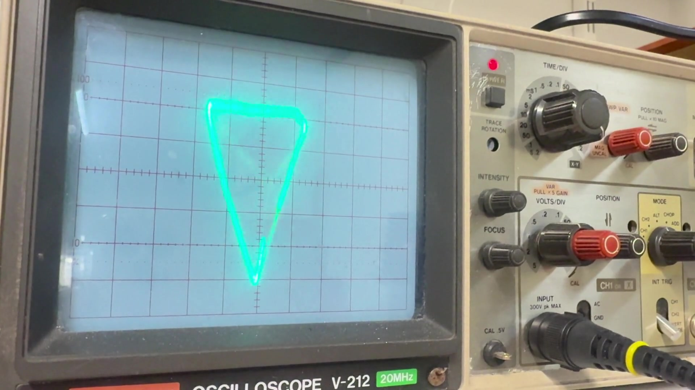

# Matzo Vector Scope

Vektorgrafik på ett analogt oscilloskop med NodeMCU/ESP8266. Två filtrerade PWM-utgångar styr X och Y. Projektet utvecklas med ett Hitachi V-212 i X–Y-läge.

## Demonstration

[](docs/videos/matzo-vector-scope-silent.mp4)

[Öppna den ljudlösa demonstrationsvideon](docs/videos/matzo-vector-scope-silent.mp4). Videon är cirka 13 sekunder lång och sparad som MP4 i 1080p med originalets bildfrekvens. Alla ljudspår är borttagna. HDR-färgerna har anpassats för vanlig SDR-uppspelning.

## Former

Programmet visar en form i taget: kub, cirkel, oktaeder, tetraeder, pyramid, blomkurva, rymdskepp och en tredimensionell slinga. Det använder heltalsberäkningar och en sinustabell. Varje form visas i sju sekunder och hela showen upprepas.

Text, stjärnbakgrund och separata vektorbollar ingår inte i den aktuella versionen.

## Delar

- NodeMCU med ESP8266.
- Två motstånd på 4,7 kΩ.
- Två kondensatorer på 100 nF, normalt märkta `104`.
- Kopplingsdäck och ledningar.
- Två prober eller BNC-kablar och ett oscilloskop med X–Y-läge.
- USB-kabel som stöder dataöverföring.

## Koppling

| NodeMCU | GPIO i koden | Oscilloskop |
| --- | --- | --- |
| D1 | 5 | CH1 / X |
| D2 | 4 | CH2 / Y |
| GND | — | Båda probjordarna och kondensatorernas jordben |

Varje kanal har ett eget RC-filter. Anslut probspetsen efter motståndet, på samma punkt som kondensatorns signalben:

```text
D1 ──[4,7 kΩ]──┬──── CH1 / X
               │
             [100 nF]
               │
              GND

D2 ──[4,7 kΩ]──┬──── CH2 / Y
               │
             [100 nF]
               │
              GND
```

Mata NodeMCU via USB. Anslut oscilloskopets jordklämmor till kretsens GND. Kondensatorerna laddas och laddas ur genom motstånden, så att PWM-pulserna blir en jämnare analog spänning. Filtrets tidskonstant är cirka 470 µs och dess gränsfrekvens cirka 339 Hz.

## Ladda upp

1. Installera ESP8266-kortstödet i Arduino IDE enligt [projektets installationsanvisning](https://arduino-esp8266.readthedocs.io/en/latest/installing.html).
2. Öppna `MatzoShapes.ino`. Behåll filen i en mapp som heter `MatzoShapes` när du öppnar den med Arduino IDE.
3. Välj **NodeMCU 1.0 (ESP-12E Module)** och kortets USB-port.
4. Börja med **Upload Speed: 115200** och ladda upp.
5. Öppna Serial Monitor på **115200 baud** om du vill se scenbytena.

Om uppladdningen fastnar vid `Connecting...`, koppla först bort externa anslutningar. Håll sedan FLASH inne och tryck kort på RST. Släpp FLASH när uppladdningen börjar.

## Hitachi V-212

- TIME/DIV: **X–Y**.
- CH1 och CH2: **DC-koppling**.
- Börja med **0,5 V/div** på båda kanalerna.
- Båda VAR-rattarna i **CAL** och förstärkningsrattarna intryckta.
- Använd samma probfaktor på båda kanalerna; ×1 passar för första försöket.
- Centrera bilden och håll ljusstyrkan måttlig. Lämna inte en stark, stillastående punkt på skärmen.

## Justeringar

Ändra konstanterna högst upp i programmet:

| Inställning | Standard | Effekt |
| --- | --- | --- |
| `MOTION_SPEED` | `2` | Rörelsehastighet. Prova `1`, `2` eller `3`. |
| `AMPLITUDE` | `100` | Figurernas storlek. Lägre värde ger mindre bild. |
| `POINT_US` | `80` | Väntetid vid varje ritpunkt. Lägre värde kan ge mer avrundning. |
| `SCENE_MS` | `7000` | Tid i millisekunder per form. |

PWM-frekvensen är 20 kHz. `analogWriteFreq()` stöder upp till 40 kHz i ESP8266:s Arduino-stöd, men högre frekvens belastar processorn mer. Ändra en inställning i taget. [PWM-dokumentation](https://arduino-esp8266.readthedocs.io/en/latest/reference.html#analog-output).

## Status och begränsningar

Enklare vektorformer har fungerat på den fysiska uppkopplingen. Den aktuella versionen har byggts utan fel för **NodeMCU 1.0 / ESP8266**, med **ESP8266 Arduino Core 3.1.2** och kortprofilen `esp8266:esp8266:nodemcuv2`.

Geometriska banor har kontrollerats för giltiga hörnreferenser, slutna banor och signalutslag vid samplade rotationer. En separat lokal kontroll med simulerade Arduino-anrop körde alla åtta scener, kontrollerade PWM-värdena och verifierade att scenloopen återgick till kuben. Videofilen har avkodats i sin helhet och verifierats sakna ljudspår.

Byggkontrollerna bekräftar att programmet kompilerar, men den aktuella showens slutliga utseende behöver fortfarande bedömas på oscilloskopet.

RC-filtren rundar av hörn och lämnar kvar viss PWM-rippel. Ingen Z-släckning används. Därför passar sammanhängande ritbanor bättre än många separata punkter eller textstreck.

## Bilder

Projektbilder läggs i [`docs/images/`](docs/images/) och videor i [`docs/videos/`](docs/videos/). Koppling, oscilloskopinställningar och fler exempel på former kan läggas till i nästa iteration.
